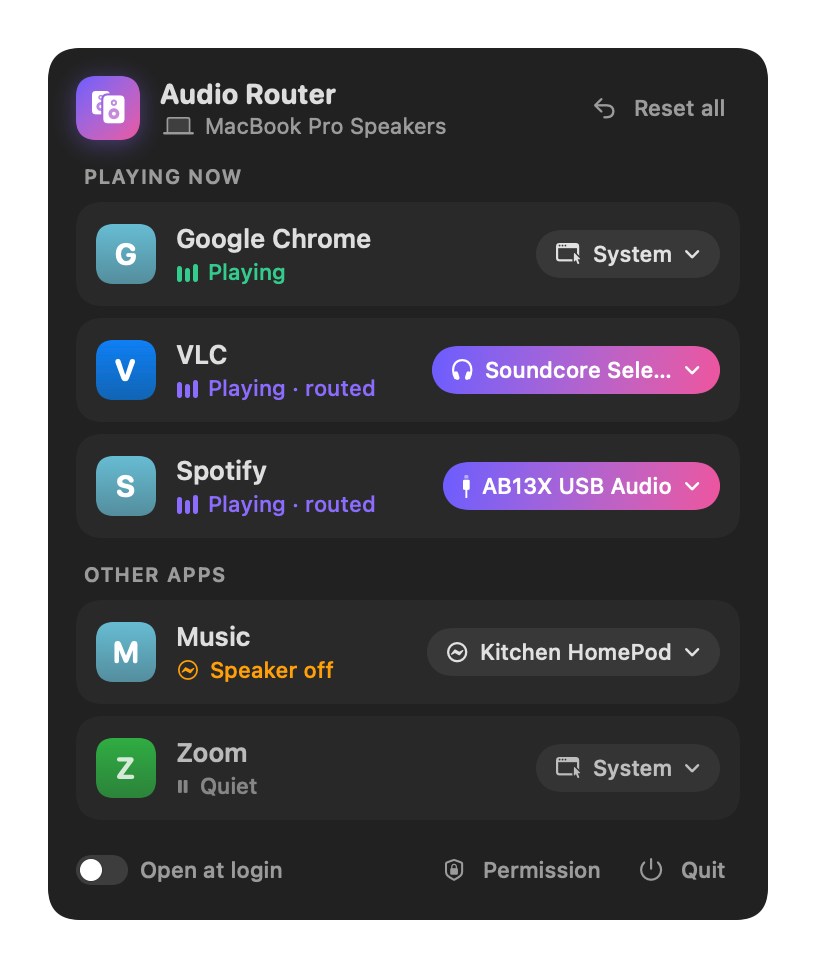
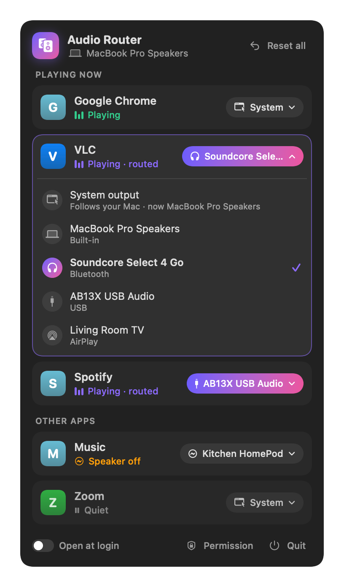
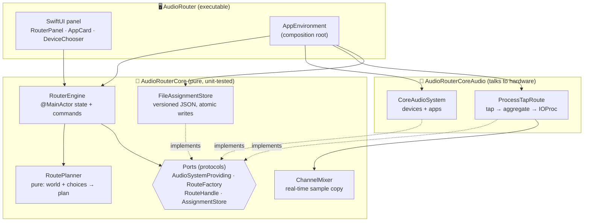
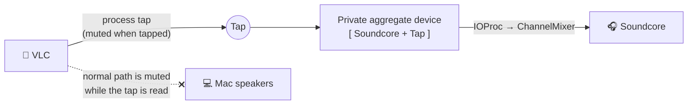
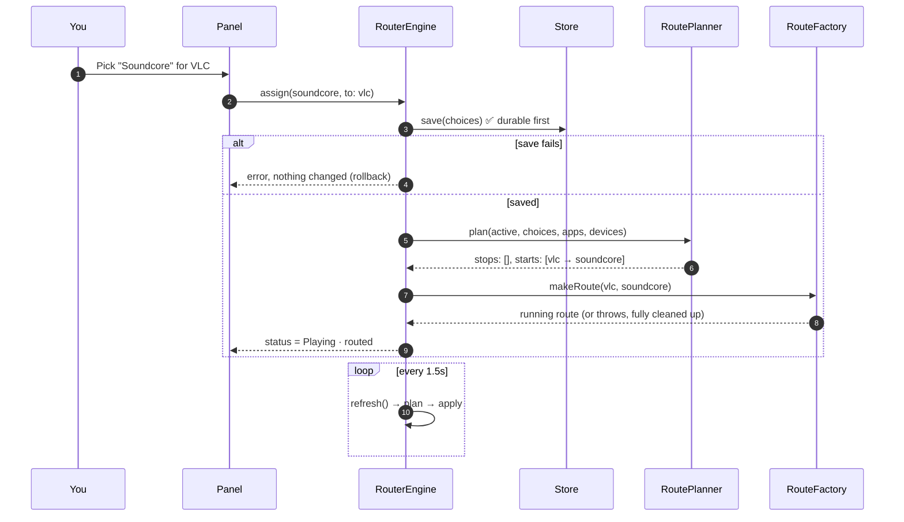

<div align="center">

# 🔀 Audio Router

**Send every app to its own speaker. From your menu bar.**

YouTube on the MacBook speakers 💻 · VLC on the Bluetooth speaker 🎧 · Spotify on the USB DAC 🔌, all at once.

[](https://github.com/katlego95/AudioRouter/actions/workflows/ci.yml)


[](LICENSE)
[](CONTRIBUTING.md)

 

</div>

---

## ⚡ Quick start

```bash
git clone https://github.com/katlego95/AudioRouter.git
cd AudioRouter
./build.sh          # builds, installs to /Applications, launches
```

That's it. No Xcode required, only the Command Line Tools (`xcode-select --install`). Look for the **two-speaker icon** in your menu bar.

> [!TIP]
> **Can't see the icon?** On MacBooks with a notch, extra menu bar icons hide behind it. Hold <kbd>⌘</kbd> and drag some other icons off the bar, or click the desktop so fewer app menus are shown.

## 🎮 How to use it

1. ▶️ **Play something** in any app. It appears under **Playing now**.
2. 🎯 **Click the pill** on the right of the app and pick a speaker.
3. 🔓 **First time only:** macOS asks to let Audio Router record system audio. Click **Allow**.

Your choices are remembered. Unplug the speaker and the app falls back to your normal output; plug it back in and it jumps back. **Quit** and everything returns to normal.

<details>
<summary><b>🧪 Try these: what happens when…</b> (click to expand)</summary>
<br>

| You do this | Audio Router does this |
|---|---|
| Pick **Soundcore** for VLC | VLC goes quiet on your Mac and plays on the Soundcore. The pill turns purple. |
| Turn the Soundcore **off** | VLC immediately falls back to your system output. Status: <code>🟠 Speaker off</code> |
| Turn it back **on** | VLC hops back to the Soundcore within ~2 seconds. |
| Open a **new Chrome tab** with audio | Chrome spawns a helper process; the tap is rebuilt to include it. |
| Pick **System output** | VLC follows whatever macOS output you chose in Control Center. |
| Click **Reset all** | Every app goes back to the system output. |
| **Quit** Audio Router | All taps are released; every app plays normally again. |

</details>

<details>
<summary><b>🔇 An app went silent after routing?</b></summary>
<br>

That's almost always the permission. Click **Permission** in the panel footer (or open *System Settings → Privacy & Security → Screen & System Audio Recording → System Audio Recording Only*) and turn on **Audio Router**. Then quit and reopen it.

Rebuilt the app yourself? Ad-hoc signed builds get a new signature each time, so macOS may ask again. Toggle the permission off and on.

</details>

<details>
<summary><b>❓ FAQ</b></summary>
<br>

- **Per tab?** No, per app. All of Chrome goes to one output.
- **Does it add latency?** A few milliseconds: one hop through a private aggregate device.
- **Does it record anything?** No. Audio is copied from the app straight to the speaker in memory and never stored.
- **Why macOS 14.2?** That's when Apple shipped Core Audio *process taps*, the API that makes per-app routing possible without a kernel extension or virtual driver.

</details>

---

## 🏗️ Architecture

Three layers. Dependencies point **inward**: the core knows nothing about Core Audio or SwiftUI.



### What a route actually is



### The control loop



### 🗂️ Project map

```
Sources/
├── AudioRouterCore/          🧠 pure logic, no side effects
│   ├── Models.swift            OutputDevice, AudioApp, Assignment, RouteStatus
│   ├── Ports.swift             the 4 protocols the engine depends on
│   ├── RoutePlanner.swift      routing policy (pure function)
│   ├── RouterEngine.swift      state + commands (@MainActor)
│   ├── FileAssignmentStore.swift  atomic, versioned JSON
│   └── ChannelMixer.swift      real-time sample copy
├── AudioRouterCoreAudio/     🔌 the only code that touches the HAL
│   ├── CoreAudioSystem.swift   lists devices + audio apps
│   ├── ProcessTapRoute.swift   tap → aggregate → IOProc
│   └── CoreAudioProperty.swift typed property helpers
└── AudioRouter/              🖥️ SwiftUI menu bar app
    ├── AudioRouterApp.swift    entry point + composition root
    ├── RouterPanel.swift       the panel
    ├── AppCard.swift           one app + inline device chooser
    ├── Components.swift        equalizer, chips, switches
    ├── Theme.swift             design tokens
    └── DemoData.swift          fake hardware for screenshots
Tests/AudioRouterCoreTests/   ✅ Swift Testing, runs without audio hardware
```

---

## 🛠️ Hacking on it

```bash
swift test                     # 48 tests, ~0.01s, no audio hardware needed
./build.sh --no-install        # build the .app into ./build
./build.sh                     # build + install + launch

# Regenerate the screenshots above from demo data (no real devices involved):
B=$(swift build -c release --show-bin-path)/AudioRouter
$B --render-preview docs/panel-dark.png --dark
$B --render-preview docs/panel-light.png
$B --render-preview docs/panel-chooser.png --dark --expanded

# Watch it work:
/usr/bin/log stream --predicate 'process == "coreaudiod" AND eventMessage CONTAINS "Muter"'
```

> [!NOTE]
> zsh has a built-in `log` command, so type `/usr/bin/log` in full.

The workflow is **test-first**: write a failing test in `Tests/` against the fakes, make it pass in `AudioRouterCore`, and only then touch adapters or UI. See [CONTRIBUTING.md](CONTRIBUTING.md).

## 🗺️ Roadmap: grab one!

- [ ] 🎚️ Per-app volume slider (a `ChannelMixer` gain, fully testable)
- [ ] 🔔 React to device changes via HAL property listeners instead of polling
- [ ] 🔊 Send one app to **two** speakers at once
- [ ] ⌨️ Global shortcut to open the panel
- [ ] 🌍 Localisation
- [ ] 📦 Signed + notarised release builds via GitHub Actions
- [ ] 🧪 Snapshot tests for the UI using `--render-preview`

<div align="center">
<br>

Made with 🎧 · [MIT licensed](LICENSE) · Contributions welcome

</div>
